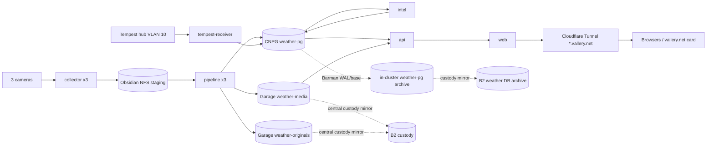

# Weather architecture

This is the current design of the service. The required outcomes are R01–R38 in [requirements](requirements.md); where the rest of that document differs from this one, this one is right. Work is tracked in GitHub issues.

## What it is

`weather.vallery.net` is a public, observational weather archive. It has three parts:

- **Telemetry.** Complete received Tempest UDP history, current conditions refreshed about every 15 s, and a local almanac.
- **Cameras.** Daytime and overnight timelapses split at civil twilight for `skycam_east`, `skycam_west` and `frontyard_1`, plus keograms, private hourly originals with public comparison stills, and delayed previews.
- **Intelligence.** Labeled AI descriptions, hybrid semantic/measured search, events and a private editor. The model only classifies frames into enums; every public sentence is rendered by server templates.

The vallery.net homepage embeds a small current-weather card. Service tier is 2: NAS-dependent capture and media outages are accepted and shown honestly in the UI.

## Components

All application workloads run in namespace `weather` and are rendered from `deploy/k8s` by Argo Application `weather`. Secrets come from the bundle `secrets/weather` in jvallery/estate-platform.

| Workload | Kind | Responsibility | State | Network egress |
|---|---|---|---|---|
| `collector-<camera>` ×3 | StatefulSet, replicas 1 | Timer-driven native snapshots → sealed TAR chunks | NFS `weather-staging` (own camera dir) | Its camera IP:port only. No DNS, API, DB or internet; no SA token |
| `tempest-receiver` | Deployment, Recreate | UDP 50222 on the VLAN-10 network attachment `weather-tempest-vlan10` (jvallery/network-infra) → SQLite spool → CNPG | 1 GiB `longhorn-v1-rwo` spool | CNPG only; never transmits on the NAD |
| `pipeline-<camera>` ×3 | Deployment, replicas 1 | Streaming exposure accumulation → mezzanine, keogram columns, hourly candidates, preview; segment finalize/encode/validate/publish | NFS staging + previews | CNPG, Garage |
| `scheduler` | Deployment, replicas 1 | Solar schedule, job queue/outbox, hour-slot finalization, cleanup, reconciliation, GC | – | CNPG, Garage |
| `intel` | Deployment, replicas 1 | Structured frame classification (Cortex), template-rendered descriptions, embeddings, search documents | – | CNPG, Garage `weather-media` (read-only), Cortex (`cortex.vallery.net/v1`) |
| `api` | Deployment ×2 | FastAPI public API, media origin (GET/HEAD/range), operator API; mounts no NFS | – | CNPG, Garage `weather-media` (read-only), Cortex embed (query) |
| `weather-preview` | Deployment, replicas 1 | Serves eligible delayed previews only (same image, shared origin code); the only public-path pod that mounts staging | NFS `previews/` (read-only) | CNPG |
| `web` | Deployment ×2 | React Router SSR + client navigation | – | `api` only |
| `weather-pg` | CNPG Cluster, 3 instances | Canonical store; Barman Cloud plugin → NAS-backed object store `weather-pg-archive` | `longhorn-v1-rwo` | in-cluster object storage |
| `migrate` | Argo Sync hook Job, wave 1 (DB clients at wave ≥2) | Alembic migrations (migrator role) | – | CNPG |

There are two images, each built in-cluster by Kaniko, published to `registry.vallery.net/jvallery/weather-*` and pinned by digest:

- `weather-app`: Python. Every role above except `web` runs it, with the role selected by command. It includes a pinned FFmpeg.
- `weather-web`: Node SSR.

## Data flow



## Storage and identities

| Store | Contents | Writers | Readers | Recovery |
|---|---|---|---|---|
| `weather-pg` | Telemetry raw + normalized, catalog, jobs/outbox, events, editorial revisions, search documents/vectors | migrator, ingest, worker roles; api operator functions | api role (public views), worker roles | WAL (`archive_timeout` 300 s) and a daily base backup to the NAS-backed store `weather-pg-archive` (7 days); jvallery/storage-infra mirrors that bucket to B2. See the [database runbook](operations/database.md#backups-and-wal) |
| Garage `weather-media` (garage-hdd) | Renditions, posters, keograms, sanitized stills, sidecars; content-addressed and immutable | pipeline, scheduler (GC) | api (read-only key) | custody `mirror` → B2 |
| Garage `weather-originals` (garage-hdd) | One native JPEG per camera per local hour (5 years) | pipeline only | none online; custody | custody `mirror` → B2 |
| NFS `weather-staging` | Sealed chunks, per-segment mezzanine, `previews/` (about 1 h of generations; pointer rows in `camera_preview` expire at capture + 3,600 s) | collectors (own dir), pipelines | pipelines; `weather-preview` (previews, read-only) | Disposable; never backed up |
| Spool PVC | Undrained UDP datagrams | receiver | receiver | Drains to CNPG |

Browsers never see S3, the media origin serves only committed allowlisted asset IDs, and no web identity can read backups or originals (R18). The PITR window is 7 days and object GC grace is 90 days. After a restore, a reconcile job marks missing objects `unavailable`.

## Time model (invariants)

- Segments are half-open and split at civil twilight (Astral, 6° depression): daytime is [dawn, dusk) and overnight is [dusk, next dawn).
- Each camera-cycle gets exactly 7,200 output frames at 60 fps, split between its two segments in proportion to elapsed time. Frame k represents source time a + (k + ½)·step.
- Hour slots are UTC hours. The local calendar day is derived through America/Denver and carries the `weather_day` FK, so a day has 23, 24 or 25 slots.
- Golden vectors: [`docs/contracts/time-model-vectors.json`](contracts/time-model-vectors.json).
- Public images become eligible at `capture_upper_bound + 600 s + skew_margin`.

## Design rules

These rules hold across the code base. A change that breaks one is a design change: update this section in the same pull request.

**Cameras and source time.**

- Each collector polls its own camera's channel-1 snapshot endpoint (Digest auth, no redirects, fixed private destination) at the commissioned cadence, 1 Hz target. One request in flight per camera, bounded connect/read/total deadlines, staggered phases and a 16 MiB payload ceiling. An overdue slot is skipped: no overlapping requests and no catch-up burst. Never use Frigate's latest frame, recorded video or a persistent RTSP decoder as the source.
- HTTP `Date`, arrival time and equal JPEG hashes do not establish exposure time or staleness. Each capture carries source-time bounds; unknown or implausible bounds are never publicly eligible.
- A capture belongs to exactly one half-open segment by source time, independent of its request slot. No render context crosses a segment boundary because two captures share a chunk.
- All three cameras publish full views with an explicit, versioned `none` mask policy. No crops, blur or redaction; originals stay private and public derivatives strip EXIF/XMP/GPS.

**Rendering (observed-exposure profile).**

- Shutter angle θ defaults to 180°. Output frame k's intended exposure is centered on its source time with width `step × θ/360`. A capture's support reaches toward each neighbour only to the midpoint and at most half the expected capture interval, clipped to the segment.
- Exposure coverage is the union of valid support inside the shutter divided by the intended shutter width. At ≥ 0.90 (inclusive) the frame is accumulated in linear light and normalized by valid support weight; below 0.90 it gets the versioned "capture unavailable" treatment at its original PTS. The actual coverage is retained.
- Slot coverage per segment: ≥ 99 % normal, 90–99 % partial, < 90 % partial with an obvious label, < 50 % an unavailable catalog record. Slot coverage never overrides a failed shutter. No gap compresses time, changes the frame count or borrows another segment's captures.
- Keograms: 1,440 equal elapsed-UTC bins per segment, at most 512 px spatial, the valid capture nearest each bin midpoint (ties: earlier time, then capture ID); missing bins stay visible.
- Short gaps are filled with a linear cross-fade and long ones with a labelled held frame ([gap-fill record](decisions/2026-10-26-gap-fill-interpolation.md)). There is no motion interpolation and no GPU rendering path.
- Changing θ, the coverage threshold, the support rule or any normalization, encode or overlay setting creates a new recipe version, chosen on comparison clips. Each output records the recipe version it was rendered with.

**Web UI and framing.**

- React Router SSR with client navigation. Archive links, video detail, timestamps, descriptions and downloads work without JavaScript. The Node server reads only the public API; it has no database, camera, model, Garage or identity authority.
- Current conditions poll about every 15 s with one request in flight, bounded backoff and a pause while hidden; no retry bursts or extra focus/reconnect polling. Polling never resets `observed_at`, `received_at` or `valid_until`. API state is never persisted in localStorage, IndexedDB or a service worker.
- Private editor data is fetched by authenticated same-origin calls and never serialized into SSR hydration. Narrative and editorial text render as escaped text; no model HTML. Scripts, fonts, icons and player assets are self-hosted under a restrictive CSP without `unsafe-inline` or eval.
- Theme: the vallery.net palette with semantic roles (ink `#112231`, muted `#626b76`, forest `#0e5a43` for links, buttons and focus; mint and gold only as accents with ink text). Focus is a 2 px forest outline with a 2 px white separation; targets are at least 44 px; the shell is at most 80 rem with 1 rem mobile gutters. Charts use labels/patterns and gaps, never colour alone.
- Product cards label capturing, queued, processing, published, partial, unavailable or expired, with analysis state labelled separately. One active video player; no autoplay.
- `/embed/weather/` alone sends `frame-ancestors https://vallery.net` and omits `X-Frame-Options`; every other route denies framing. The card uses no privileged cookies, parent DOM access or postMessage. Its homepage placement is the full-width section after "What I am doing now" (wordpress#242).

**Media transport and caches.**

- One browser origin for pages, API, playback and downloads through the Cloudflare Tunnel. Browsers never get object-store URLs or redirects. Each GET, HEAD and range request is authorized at request time against the committed publication row, including `public_not_before`; there are no mid-stream leases.
- Media bytes, posters, aliases, downloads, preview pointers and their errors are `Cache-Control: no-store` and bypass shared edge caches. Media has a strong ETag for If-Range only: no 304, 412 or Last-Modified (#20), and no validator bypasses authorization. Hashed JS/CSS may use long immutable caching. Current-weather JSON keeps its own short `max-age` (≤ 5 s).
- One byte range per request: multiple ranges return 400, a valid unsatisfiable range 416, and HEAD ignores Range ([range policy](contracts/api-contract.md#range-policy)). No transformation or compression of media bytes. A mid-stream failure terminates the transfer; an error page is never appended to media bytes.
- Enabling edge media caching later needs a replacement design with a finite exposure bound and invalidation of every alias.

**Search.**

- Query at most 512 Unicode scalars with no control characters, at most 8 measured predicates, `top_k` 1–20 and an explicit UTC interval; nothing is silently truncated or widened.
- Search responses and errors are `no-store`, with no application result cache.
- Video-level documents are embedded with `embed.main` and compared by exact cosine (no approximate index). Window-level matches come from PostgreSQL full-text search and the typed measured filters, fused with the semantic results by reciprocal rank. A profile change re-embeds and flips a `profile_id`; there are no shadow generations and no query-vector cache. Numeric-only search works while inference is offline.
- Edge limits are the Traefik `rateLimit` and `inFlightReq` middlewares keyed on `Cf-Connecting-Ip` (trustworthy because the origin is reachable only through the tunnel), plus one in-process semaphore.
- 400 for invalid input, 429 with `Retry-After` for admission or rate rejection, 503 for unavailable SQL or deadline. An embedding failure alone yields a labelled lexical fallback, never an empty success.

**Staging and capture chunks.**

- Each camera has one collector (`replicas: 1` StatefulSet) with camera-only egress and no database or API access. Chunk names include the pod UID and incarnation, so two writers can never overwrite each other. A chunk is one TAR (frames plus an attempt manifest) sealed by `fsync` and `rename` into `sealed/<camera>/<utc-hour>/`. A soft-mount error abandons the chunk and records a gap.
- Accepted frames are deduplicated by `(camera, slot)`; the best attempt wins and duplicates are recorded.
- Sealed chunks are processed as they arrive. One pass yields the finished output frames (a near-lossless per-segment mezzanine on the staging share), keogram columns, hourly-original candidates and the latest preview candidate; at the segment boundary only concatenation, the three encodes and validation remain.
- The catalog rows decide what may be deleted. A raw chunk goes only when its frames are in a durable mezzanine, its keogram strip is committed, every overlapping hour slot is finalized with its original archived and read back, and its preview window has passed.

**Telemetry.**

- One receiver (`Recreate`) binds only UDP 50222 on the VLAN-10 attachment and never transmits there. It runs non-root with no capabilities and a read-only root filesystem. A gap of a minute or two while it reschedules is accepted and shows in coverage.
- The spool is SQLite in WAL mode with `synchronous=FULL`. The receiver inserts the raw bytes, drains to PostgreSQL in batches and deletes on commit. Rows deduplicate on `(device, message_type, source_ts, row)` with `ON CONFLICT`. The store is the raw receipt plus the typed family tables; there is no conflict, provenance or transport layer on top.
- A replaced station is a new `device` row with validity dates; records and the almanac continue across devices at the same site.

**Database.**

- `weather-pg` has three instances on `longhorn-v1-rwo` with one synchronous standby (`minSyncReplicas` and `maxSyncReplicas` 1, `synchronous_commit=on`) and required anti-affinity across Proxmox hosts. Tables are not partitioned; time columns use BRIN. Revisit above about 200 million telemetry rows.
- Migrations are Alembic, run by the sync-hook Job `weather-migrate` at wave 1 under a dedicated migrator role; database clients start at wave 2 or later. Migrations have run in production, so every change is expand and contract.
- Aggregates are computed on read with SQL `date_bin` plus coverage and carry an evidence count and hash, not ID lists. Nothing is stored, so a corrected or late row changes the next read.

**Objects and recovery.**

- `weather-media` holds videos, posters, keograms, sanitized stills and sidecars; the media origin holds only its read-only key. `weather-originals` holds the private hourly JPEGs; its read-write key exists only in the pipeline. Keys are content-addressed and immutable (`<class>/<sha256>.<ext>`); a writer never overwrites a different hash.
- Previews are not stored in object storage or backed up. The pipeline writes them to the staging share's `previews/` directory with a database pointer, and only `weather-preview` mounts that directory. The `api` never mounts NFS, so a NAS outage cannot block its start-up or current conditions.
- No object referenced by any restorable catalog state is deleted: GC grace (90 days) exceeds the PITR window and the B2 version retention. After a restore, the reconcile job checks every referenced object and marks missing ones `unavailable`, a state the UI already shows. Keograms follow the stills lifecycle, not video expiry.
- Retention: videos 365 days, hourly originals 5 years. A hard purge for third-party privacy overrides GC grace only on Jason's explicit instruction and leaves an audit row ([media runbook](operations/media.md)).

**AI descriptions.**

- The model sees sampled frames of each published rendition (per hour window) plus the segment keogram, and returns strict structured JSON: category, assessment, confidence, optional intensity and sky-cover enums, limitation codes and the supplied evidence IDs. Free text is rejected and survives only in the private raw-response table, which expires after 24 h.
- No model-written prose is ever published. Public summaries, claims, limitations and search text are rendered by fixed server templates from accepted observations and station aggregates, with numbers formatted by code. `possible` and low-confidence `visible` always render hedged; absence is worded only from a full-coverage measured zero or an explicit "not visible in the frames".
- Inference concurrency is 1 (a PostgreSQL advisory lock), with a client timeout and a bounded nightly retry. An analysis is pinned to the model and prompt version at publication; the archive is not re-analysed automatically.

**API, editor and previews.**

- The API is code-first: the Pydantic models generate the OpenAPI document and `openapi-typescript` generates the web types, which are the web's only type source. [api-contract.md](contracts/api-contract.md) is the semantic contract.
- `/editor` and `/api/v1/operator/*` sit behind Authentik forward-auth. The API trusts the identity header only from Traefik (enforced by NetworkPolicy) and checks a one-user allowlist. CSRF protection is `SameSite=Strict` plus an Origin check.
- A preview frame is eligible when `capture_upper_bound + 600 s + skew_margin ≤ now`. The skew margin defaults to 30 s on NTP-synced nodes, and a clock-offset alert covers it. Unknown or implausible timing is never eligible.
- Display units default to US customary with a metric toggle; the site is English only. Telemetry history comes from direct UDP capture, plus the one-off import described in the [telemetry runbook](operations/telemetry.md).

**Service objectives (30-day windows).**

1. A segment is published within 2 h of its boundary for at least 95 % of segments.
2. Current-conditions age is at most 90 s for 99 % of the time while the station is reporting.
3. Public page and media probe availability is at least 99.5 %. A 24-hour check means that ratio over the trailing 24 hours; one failure counts against the ratio and does not reset it.
4. Database offsite age is at most 26 h.

Everything else is a signal, not an objective. Weather exposes `/metrics`; the scrape jobs, rules, probes and dashboards are in jvallery/monitoring-stack.

## Repository layout

```text
app/weather/      Python package: timemodel, capture, telemetry, pipeline, products, publish,
                  media, ai, search, api, db (SQLAlchemy models), cli (role entrypoints)
app/migrations/   Alembic
app/tests/        pytest (unit + integration against ephemeral Postgres/pgvector and Garage)
web/              React Router (TypeScript), Vitest, Playwright + axe
deploy/k8s/       Kustomize rendered by Argo: namespace, quotas, netpols, CNPG, workloads, IngressRoutes
docs/             requirements, architecture, contracts, operations (runbooks), design records
scripts/ci.sh     single check entrypoint, called by .github/workflows/ci.yml on the estate-ci runners
Dockerfile.app, Dockerfile.web
```

Pins start from [backend](research/backend-pin-evidence.json) and [frontend](research/frontend-pin-evidence.json) pin evidence; lockfiles become the source of truth. Charts use uPlot (time series, linked cursor) and d3-shape (wind rose).

## Estate alignment

- **Ownership.** This repository owns namespace `weather` and what `deploy/k8s` renders into it. The neighbouring owners (Argo CD Applications and Secrets, network attachment and tunnel, buckets and NFS, monitoring, cameras, inference) are listed in [AGENTS.md](../AGENTS.md#neighbours).
- **Standards.** The estate [STANDARDS.md](https://github.com/jvallery/estate-platform/blob/main/docs/estate/STANDARDS.md) controls are met through the usual patterns: restricted Pod Security, default-deny NetworkPolicies, SOPS-encrypted Secrets, digest-pinned in-cluster builds, a public read-only route with the editor behind Authentik forward-auth, a 7-day PITR archive with an offsite mirror and restore drills, and custody mirrors with their own backup-age alerts.
- **Execution placement.** Builds, test suites, render pilots and media processing run in the cluster through GitHub Actions on the estate-ci runners or as `weather` workloads, not on a workstation. Pilots run in disposable namespaces.
