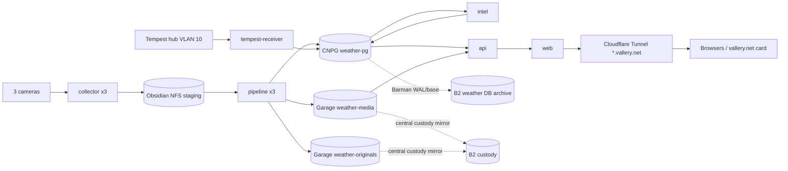

# Weather architecture

**Status:** authoritative design summary as of 2026-10-24 ([simplification record](decisions/2026-10-24-simplification.md), amended by the [takeover re-plan](decisions/2026-10-24-takeover-replan.md)). Required outcomes: [requirements](requirements.md) R01–R38, as amended by those records. Live state: the walking skeleton only (API `/healthz` and the scaffold web image); no slice is launched. GitHub issues and their native dependencies are the work plan.

## What it is

`weather.vallery.net` is a public, observational weather archive. It has three parts:

- **Telemetry.** Complete received Tempest UDP history, current conditions refreshed about every 15 s, and a local almanac.
- **Cameras.** Daytime and overnight timelapses split at civil twilight for `skycam_east`, `skycam_west` and `frontyard_1`, plus keograms, private hourly originals with public comparison stills, and delayed previews.
- **Intelligence.** Labeled AI descriptions, hybrid semantic/measured search, events and a private editor.

The vallery.net homepage embeds a small current-weather card. Service tier is 2: NAS-dependent capture and media outages are accepted and shown honestly in the UI.

## Components

All application workloads run in namespace `weather` and are rendered from `deploy/k8s` by Argo Application `weather`. Secrets come from agents `secrets-ksops/weather`.

| Workload | Kind | Responsibility | State | Network egress |
|---|---|---|---|---|
| `collector-<camera>` ×3 | StatefulSet, replicas 1 | Timer-driven native snapshots → sealed TAR chunks | NFS `weather-staging` (own camera dir) | Its camera IP:port only. No DNS, API, DB or internet; no SA token |
| `tempest-receiver` | Deployment, Recreate | UDP 50222 on the agents-owned VLAN-10 `vlan` NAD → SQLite spool → CNPG | 1 GiB `longhorn-v1-rwo` spool | CNPG only; never transmits on the NAD |
| `pipeline-<camera>` ×3 | Deployment, replicas 1 | Streaming exposure accumulation → mezzanine, keogram columns, hourly candidates, preview; segment finalize/encode/validate/publish | NFS staging + previews | CNPG, Garage |
| `scheduler` | Deployment, replicas 1 | Solar schedule, job queue/outbox, hour-slot finalization, cleanup, reconciliation, GC | – | CNPG, Garage |
| `intel` | Deployment, replicas 1 | AI descriptions, embeddings, search documents | – | CNPG, Garage `weather-media` (read-only), Cortex (`cortex.vallery.net/v1`) |
| `api` | Deployment ×2 | FastAPI public API, media origin (GET/HEAD/range), operator API; mounts no NFS | – | CNPG, Garage `weather-media` (read-only), Cortex embed (query) |
| `weather-preview` | Deployment, replicas 1 | Serves eligible delayed previews only (same image, shared origin code); the only public-path pod that mounts staging | NFS `previews/` (read-only) | CNPG |
| `web` | Deployment ×2 | React Router SSR + client navigation | – | `api` only |
| `weather-pg` | CNPG Cluster, 3 instances | Canonical store; Barman → B2 | `longhorn-v1-rwo` | B2 |
| `migrate` | Argo Sync hook Job, wave 1 (DB clients at wave ≥2) | Alembic migrations (migrator role) | – | CNPG |

There are two images, each built in-cluster by Kaniko, published to `registry.vallery.net/jvallery/weather-*` and pinned by digest:

- `weather-app`: Python. Every role above except `web` runs it, with the role selected by command. It includes a pinned FFmpeg.
- `weather-web`: Node SSR.

## Data flow



## Storage and identities

| Store | Contents | Writers | Readers | Recovery |
|---|---|---|---|---|
| `weather-pg` | Telemetry raw + normalized, catalog, jobs/outbox, events, editorial revisions, search documents/vectors | migrator, ingest, worker roles; api operator functions | api role (public views), worker roles | Barman → dedicated B2 bucket, PITR, `archive_timeout` 300 s |
| Garage `weather-media` (garage-hdd) | Renditions, posters, keograms, sanitized stills, sidecars; content-addressed and immutable | pipeline, scheduler (GC) | api (read-only key) | custody `mirror` → B2 |
| Garage `weather-originals` (garage-hdd) | One native JPEG per camera per local hour (5 years) | pipeline only | none online; custody | custody `mirror` → B2 |
| NFS `weather-staging` | Sealed chunks, per-segment mezzanine, `previews/` (about 1 h of generations; pointer rows in `camera_preview` expire at capture + 3,600 s) | collectors (own dir), pipelines | pipelines; `weather-preview` (previews, read-only) | Disposable; never backed up |
| Spool PVC | Undrained UDP datagrams | receiver | receiver | Drains to CNPG |

R18 holds natively: browsers never see S3, the media origin serves only committed allowlisted asset IDs, and no web identity can read backups or originals. The PITR window is 30 days and object GC grace is 90 days. After a restore, a reconcile job marks missing objects `unavailable`.

## Time model (invariants)

- Segments are half-open and split at civil twilight (Astral, 6° depression): daytime is [dawn, dusk) and overnight is [dusk, next dawn).
- Each camera-cycle gets exactly 7,200 output frames at 60 fps, split between its two segments in proportion to elapsed time. Frame k represents source time a + (k + ½)·step.
- Hour slots are UTC hours. The local calendar day is derived through America/Denver and carries the `weather_day` FK, so a day has 23, 24 or 25 slots.
- Golden vectors: [`docs/contracts/time-model-vectors.json`](contracts/time-model-vectors.json).
- Public images become eligible at `capture_upper_bound + 600 s + skew_margin`.

## Rules carried from ADRs

The ADRs D01–D16 are historical. These are the rules from them that still bind; the issue acceptance lists hold the test cases.

**Cameras and source time (D02).**

- Each collector polls its own camera's channel-1 snapshot endpoint (Digest auth, no redirects, fixed private destination) at the commissioned cadence, 1 Hz target. One request in flight per camera, bounded connect/read/total deadlines, staggered phases and a 16 MiB payload ceiling. An overdue slot is skipped: no overlapping requests and no catch-up burst. Never use Frigate's latest frame, recorded video or a persistent RTSP decoder as the source.
- HTTP `Date`, arrival time and equal JPEG hashes do not establish exposure time or staleness. Each capture carries source-time bounds; unknown or implausible bounds are never publicly eligible.
- A capture belongs to exactly one half-open segment by source time, independent of its request slot. No render context crosses a segment boundary because two captures share a chunk.
- All three cameras publish full views with an explicit, versioned `none` mask policy (Jason, 2026-10-23). No crops, blur or redaction; originals stay private and public derivatives strip EXIF/XMP/GPS.

**Rendering (D10, observed-exposure profile).**

- Shutter angle θ defaults to 180°. Output frame k's intended exposure is centered on its source time with width `step × θ/360`. A capture's support reaches toward each neighbour only to the midpoint and at most half the expected capture interval, clipped to the segment.
- Exposure coverage is the union of valid support inside the shutter divided by the intended shutter width. At ≥ 0.90 (inclusive) the frame is accumulated in linear light and normalized by valid support weight; below 0.90 it gets the versioned "capture unavailable" treatment at its original PTS. The actual coverage is retained.
- Slot coverage per segment: ≥ 99 % normal, 90–99 % partial, < 90 % partial with an obvious label, < 50 % an unavailable catalog record. Slot coverage never overrides a failed shutter. No gap compresses time, changes the frame count or borrows another segment's captures.
- Keograms: 1,440 equal elapsed-UTC bins per segment, at most 512 px spatial, the valid capture nearest each bin midpoint (ties: earlier time, then capture ID); missing bins stay visible.
- Changing θ, the coverage threshold, the support rule or any normalization, encode or overlay setting creates a new recipe version, chosen on comparison clips. Each output records the recipe version it was rendered with.

**Web UI and framing (D13).**

- React Router SSR with client navigation. Archive links, video detail, timestamps, descriptions and downloads work without JavaScript. The Node server reads only the public API; it has no database, camera, model, Garage or identity authority.
- Current conditions poll about every 15 s with one request in flight, bounded backoff and a pause while hidden; no retry bursts or extra focus/reconnect polling. Polling never resets `observed_at`, `received_at` or `valid_until`. API state is never persisted in localStorage, IndexedDB or a service worker.
- Private editor data is fetched by authenticated same-origin calls and never serialized into SSR hydration. Narrative and editorial text render as escaped text; no model HTML. Scripts, fonts, icons and player assets are self-hosted under a restrictive CSP without `unsafe-inline` or eval.
- Theme: the vallery.net palette with semantic roles (ink `#112231`, muted `#626b76`, forest `#0e5a43` for links, buttons and focus; mint and gold only as accents with ink text). Focus is a 2 px forest outline with a 2 px white separation; targets are at least 44 px; the shell is at most 80 rem with 1 rem mobile gutters. Charts use labels/patterns and gaps, never colour alone.
- Product cards label capturing, queued, processing, published, partial, unavailable or expired, with analysis state labelled separately. One active video player; no autoplay.
- `/embed/weather/` alone sends `frame-ancestors https://vallery.net` and omits `X-Frame-Options`; every other route denies framing. The card uses no privileged cookies, parent DOM access or postMessage. Its homepage placement is the full-width section after "What I am doing now" (wordpress#242).

**Media transport and caches (D14, with P8).**

- One browser origin for pages, API, playback and downloads through the Cloudflare Tunnel. Browsers never get object-store URLs or redirects. Each GET, HEAD and range request is authorized at request time against the committed publication row, including `public_not_before`; there are no mid-stream leases.
- Media bytes, posters, aliases, downloads, preview pointers and their errors are `Cache-Control: no-store` and bypass shared edge caches. Media has a strong ETag for If-Range only: no 304, 412 or Last-Modified (#20), and no validator bypasses authorization. Hashed JS/CSS may use long immutable caching. Current-weather JSON keeps its own short `max-age` (≤ 5 s).
- One byte range per request: multiple ranges return 400, a valid unsatisfiable range 416, and HEAD ignores Range ([range policy](contracts/api-contract.md#range-policy)). No transformation or compression of media bytes. A mid-stream failure terminates the transfer; an error page is never appended to media bytes.
- Enabling edge media caching later needs a replacement design with a finite exposure bound and invalidation of every alias.

**Search request ceilings (D12).**

- Query at most 512 Unicode scalars with no control characters, at most 8 measured predicates, `top_k` 1–20 and an explicit UTC interval; nothing is silently truncated or widened.
- Search responses and errors are `no-store`, with no application result cache.
- 400 for invalid input, 429 with `Retry-After` for admission or rate rejection, 503 for unavailable SQL or deadline. An embedding failure alone yields a labelled lexical fallback, never an empty success.

## Repository layout (target)

```text
app/weather/      Python package: timemodel, capture, telemetry, pipeline, products, publish,
                  media, ai, search, api, db (SQLAlchemy models), cli (role entrypoints)
app/migrations/   Alembic
app/tests/        pytest (unit + integration against ephemeral Postgres/pgvector and Garage)
web/              React Router (TypeScript), Vitest, Playwright + axe
deploy/k8s/       Kustomize rendered by Argo: namespace, quotas, netpols, CNPG, workloads, IngressRoutes
docs/             requirements, architecture, decisions, contracts, operations (runbooks)
scripts/ci.sh     single check entrypoint used by fleet ci_submission
Dockerfile.app, Dockerfile.web
```

Pins start from [backend](research/backend-pin-evidence.json) and [frontend](research/frontend-pin-evidence.json) pin evidence; lockfiles become the source of truth. Charts use uPlot (time series, linked cursor) and d3-shape (wind rose).

## Delivery slices

| Slice | Goes public when | Issues (numbers; see the [takeover re-plan](decisions/2026-10-24-takeover-replan.md#critical-path-and-order) for order) |
|---|---|---|
| 0 Foundation | done: skeleton live | #2, #3, #9, #10 closed; #6 database, #74 schema baseline |
| 1 Live weather | #48 passes | #73, #5, #14, #21; #42 almanac and #45 card follow |
| 2 Timelapse | #49 passes | #75, #4, #15, #18, #19, #20, #37, #38, #39, #40; #77 restore smoke |
| 3 Intelligence | #50 passes | #23, #25, #27, #41, #44, #78 |
| Closeout | #36 | #33 joint drill, wordpress#242 homepage card, 14-day SLO evidence, #79 dated GC follow-up |
| Non-blocking | – | #76 cleanup, #16 interpolation pilot, #46 composite, #47 visual index |

## Estate alignment

- **Ownership** follows the estate lanes: agents (registry, AppProject/Application, KSOPS, Authentik), storage-infra (buckets, keys, custody, NFS PV, B2), network-infra (IPAM, hostname record), monitoring-stack (rules, probes, dashboards), sentinel (camera access) and cortex-ai-compute (inference keys). The owner table is in the simplification record.
- **Standards.** The applicable [STANDARDS.md](https://github.com/jvallery/agents/blob/main/docs/estate/STANDARDS.md) controls are met through existing patterns:
  - **Security and exposure:** restricted PSA; default-deny NetworkPolicies; KSOPS secrets; digest-pinned in-cluster builds; public read-only route; editor behind Authentik forward-auth.
  - **Durability:** a dedicated backup bucket with a non-deleting writer key and PITR drills; custody mirrors with separate backup-age alerts.
  - **Observability:** delivered through monitoring-stack.
  - **Inherited and disclosed, not gated:** STD-DR-05 bootstrap, CI-04 signature admission, CNPG primary PDB, and the DR-01 third copy (a WX-35 decision).
  - Pilots run in R23 disposable namespaces.
- **Execution placement.** Mac sessions edit and orchestrate. Builds, test suites, render pilots and media processing run in-cluster through fleet CI or `weather` workloads.
