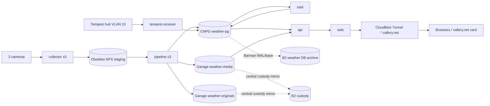

# Weather architecture

**Status:** authoritative design summary as of 2026-10-24 ([simplification record](decisions/2026-10-24-simplification.md), amended by the [takeover re-plan](decisions/2026-10-24-takeover-replan.md)). Required outcomes: [requirements](requirements.md) R01–R38, as amended by those records. Live state: the walking skeleton only (API `/healthz` and the scaffold web image); no slice is launched. GitHub issues and their native dependencies are the work plan.

## What it is

`weather.vallery.net` is a public, observational weather archive. It has three parts:

- **Telemetry.** Complete received Tempest UDP history, current conditions refreshed about every 15 s, and a local almanac.
- **Cameras.** Daytime and overnight timelapses split at civil twilight for `skycam_east`, `skycam_west` and `frontyard_1`, plus keograms, private hourly originals with public comparison stills, and delayed previews.
- **Intelligence.** Labeled AI descriptions, hybrid semantic/measured search, events and a private editor.

The vallery.net homepage embeds a small current-weather card. Service tier is 2: NAS-dependent capture and media outages are accepted and shown honestly in the UI.

## Components

All application workloads run in namespace `weather` and are rendered from `deploy/k8s` by Argo Application `weather`. Secrets come from agents `secrets-ksops/weather`.

| Workload | Kind | Responsibility | State | Network egress |
|---|---|---|---|---|
| `collector-<camera>` ×3 | StatefulSet, replicas 1 | Timer-driven native snapshots → sealed TAR chunks | NFS `weather-staging` (own camera dir) | Its camera IP:port only. No DNS, API, DB or internet; no SA token |
| `tempest-receiver` | Deployment, Recreate | UDP 50222 on the agents-owned VLAN-10 `vlan` NAD → SQLite spool → CNPG | 1 GiB `longhorn-v1-rwo` spool | CNPG only; never transmits on the NAD |
| `pipeline-<camera>` ×3 | Deployment, replicas 1 | Streaming exposure accumulation → mezzanine, keogram columns, hourly candidates, preview; segment finalize/encode/validate/publish | NFS staging + previews | CNPG, Garage |
| `scheduler` | Deployment, replicas 1 | Solar schedule, job queue/outbox, hour-slot finalization, cleanup, reconciliation, GC | – | CNPG, Garage |
| `intel` | Deployment, replicas 1 | AI descriptions, embeddings, search documents | – | CNPG, Cortex (`cortex.vallery.net/v1`) |
| `api` | Deployment ×2 | FastAPI public API, media origin (GET/HEAD/range), operator API; mounts no NFS | – | CNPG, Garage `weather-media` (read-only), Cortex embed (query) |
| `weather-preview` | Deployment, replicas 1 | Serves eligible delayed previews only (same image, shared origin code); the only public-path pod that mounts staging | NFS `previews/` (read-only) | CNPG |
| `web` | Deployment ×2 | React Router SSR + client navigation | – | `api` only |
| `weather-pg` | CNPG Cluster, 3 instances | Canonical store; Barman → B2 | `longhorn-v1-rwo` | B2 |
| `migrate` | Argo Sync hook Job, wave 1 (DB clients at wave ≥2) | Alembic migrations (migrator role) | – | CNPG |

There are two images, each built in-cluster by Kaniko, published to `registry.vallery.net/jvallery/weather-*` and pinned by digest:

- `weather-app`: Python. Every role above except `web` runs it, with the role selected by command. It includes a pinned FFmpeg.
- `weather-web`: Node SSR.

## Data flow



## Storage and identities

| Store | Contents | Writers | Readers | Recovery |
|---|---|---|---|---|
| `weather-pg` | Telemetry raw + normalized, catalog, jobs/outbox, events, editorial revisions, search documents/vectors | migrator, ingest, worker roles; api operator functions | api role (public views), worker roles | Barman → dedicated B2 bucket, PITR, `archive_timeout` 300 s |
| Garage `weather-media` (garage-hdd) | Renditions, posters, keograms, sanitized stills, sidecars; content-addressed and immutable | pipeline, scheduler (GC) | api (read-only key) | custody `mirror` → B2 |
| Garage `weather-originals` (garage-hdd) | One native JPEG per camera per local hour (5 years) | pipeline only | none online; custody | custody `mirror` → B2 |
| NFS `weather-staging` | Sealed chunks, per-segment mezzanine, `previews/` | collectors (own dir), pipelines | pipelines; `weather-preview` (previews, read-only) | Disposable; never backed up |
| Spool PVC | Undrained UDP datagrams | receiver | receiver | Drains to CNPG |

R18 holds natively: browsers never see S3, the media origin serves only committed allowlisted asset IDs, and no web identity can read backups or originals. The PITR window is 30 days and object GC grace is 90 days. After a restore, a reconcile job marks missing objects `unavailable`.

## Time model (invariants)

- Segments are half-open and split at civil twilight (Astral, 6° depression): daytime is [dawn, dusk) and overnight is [dusk, next dawn).
- Each camera-cycle gets exactly 7,200 output frames at 60 fps, split between its two segments in proportion to elapsed time. Frame k represents source time a + (k + ½)·step.
- Hour slots are UTC hours. The local calendar day is derived through America/Denver and carries the `weather_day` FK, so a day has 23, 24 or 25 slots.
- Golden vectors: [`docs/contracts/time-model-vectors.json`](contracts/time-model-vectors.json).
- Public images become eligible at `capture_upper_bound + 600 s + skew_margin`.

## Repository layout (target)

```text
app/weather/      Python package: timemodel, capture, telemetry, pipeline, products, publish,
                  media, ai, search, api, db (SQLAlchemy models), cli (role entrypoints)
app/migrations/   Alembic
app/tests/        pytest (unit + integration against ephemeral Postgres/pgvector and Garage)
web/              React Router (TypeScript), Vitest, Playwright + axe
deploy/k8s/       Kustomize rendered by Argo: namespace, quotas, netpols, CNPG, workloads, IngressRoutes
docs/             requirements, architecture, decisions, contracts, operations (runbooks)
scripts/ci.sh     single check entrypoint used by fleet ci_submission
Dockerfile.app, Dockerfile.web
```

Pins start from [backend](research/backend-pin-evidence.json) and [frontend](research/frontend-pin-evidence.json) pin evidence; lockfiles become the source of truth. Charts use uPlot (time series, linked cursor) and d3-shape (wind rose).

## Delivery slices

| Slice | Goes public when | Issues (numbers; see the [takeover re-plan](decisions/2026-10-24-takeover-replan.md#critical-path-and-order) for order) |
|---|---|---|
| 0 Foundation | done: skeleton live | #2, #3, #9, #10 closed; #6 database, #74 schema baseline |
| 1 Live weather | #48 passes | #73, #5, #14, #21; #42 almanac and #45 card follow |
| 2 Timelapse | #49 passes | #75, #4, #15, #18, #19, #20, #37, #38, #39, #40; #77 restore smoke |
| 3 Intelligence | #50 passes | #23, #25, #27, #41, #44, #78 |
| Closeout | #36 | #33 joint drill, wordpress#242 homepage card, 14-day SLO evidence, #79 dated GC follow-up |
| Non-blocking | – | #76 cleanup, #16 interpolation pilot, #46 composite, #47 visual index |

## Estate alignment

- **Ownership** follows the estate lanes: agents (registry, AppProject/Application, KSOPS, Authentik), storage-infra (buckets, keys, custody, NFS PV, B2), network-infra (IPAM, hostname record), monitoring-stack (rules, probes, dashboards), sentinel (camera access) and cortex-ai-compute (inference keys). The owner table is in the simplification record.
- **Standards.** The applicable [STANDARDS.md](https://github.com/jvallery/agents/blob/main/docs/estate/STANDARDS.md) controls are met through existing patterns:
  - **Security and exposure:** restricted PSA; default-deny NetworkPolicies; KSOPS secrets; digest-pinned in-cluster builds; public read-only route; editor behind Authentik forward-auth.
  - **Durability:** a dedicated backup bucket with a non-deleting writer key and PITR drills; custody mirrors with separate backup-age alerts.
  - **Observability:** delivered through monitoring-stack.
  - **Inherited and disclosed, not gated:** STD-DR-05 bootstrap, CI-04 signature admission, CNPG primary PDB, and the DR-01 third copy (a WX-35 decision).
  - Pilots run in R23 disposable namespaces.
- **Execution placement.** Mac sessions edit and orchestrate. Builds, test suites, render pilots and media processing run in-cluster through fleet CI or `weather` workloads.
