# Weather backlog (generated)

Generated 2026-10-24T02:07Z from live GitHub readback by the 2026-10-24 re-plan. GitHub native "blocked by" relationships are authoritative; regenerate this file rather than editing it. Design: [architecture](../architecture.md), [simplification record](../decisions/2026-10-24-simplification.md).

**Spec/readback mismatches:** 0. **Ready now (9):** [#3](https://github.com/jvallery/weather/issues/3), [agents#5366](https://github.com/jvallery/agents/issues/5366), [network-infra#774](https://github.com/jvallery/network-infra/issues/774), [network-infra#775](https://github.com/jvallery/network-infra/issues/775), [storage-infra#1106](https://github.com/jvallery/storage-infra/issues/1106), [storage-infra#1107](https://github.com/jvallery/storage-infra/issues/1107), [storage-infra#1112](https://github.com/jvallery/storage-infra/issues/1112), [sentinel#550](https://github.com/jvallery/sentinel/issues/550), [cortex-ai-compute#402](https://github.com/jvallery/cortex-ai-compute/issues/402)

## slice:0-foundation

| Key | Issue | Title | Blocked by | R |
|---|---|---|---|---|
| WX-02 | [#3](https://github.com/jvallery/weather/issues/3) | Repository scaffold, pinned toolchains, scripts/ci.sh and container images | — | R02 R24 R27 |
| WX-01 | [#2](https://github.com/jvallery/weather/issues/2) | Walking skeleton live: namespace baseline, in-cluster CI/build, digest promotion, weather.vallery.net | agents#5366, #3 | R02 R08 R24 R27 R28 |
| WX-09 | [#10](https://github.com/jvallery/weather/issues/10) | Time model library: civil twilight segments, 7,200-frame allocation, calendar day and hour slots, DST golden tests | #3 | R03 R04 R05 R30 R32 R34 |
| WX-08 | [#9](https://github.com/jvallery/weather/issues/9) | Database schema v1, Alembic migrations, roles, job queue and outbox | #2, #3 | R14 R19 R20 R22 R29 R30 R31 R33 R36 |
| WX-05 | [#6](https://github.com/jvallery/weather/issues/6) | Production CNPG weather-pg with Barman to dedicated B2, scheduled backups and PITR restore drill | monitoring-stack#1072, storage-infra#1112, #2, #9 | R16 R23 R28 |

## slice:1-live-weather

| Key | Issue | Title | Blocked by | R |
|---|---|---|---|---|
| WX-11 | [#12](https://github.com/jvallery/weather/issues/12) | Tempest ingest: UDP receiver, SQLite spool, raw and normalized persistence, dedupe and coverage | #9 | R13 R14 R15 R20 |
| WX-04 | [#5](https://github.com/jvallery/weather/issues/5) | Commission the Tempest receiver on the VLAN-10 attachment with live packet reception | agents#5368, #12, #6 | R13 R27 R28 |
| WX-13 | [#14](https://github.com/jvallery/weather/issues/14) | Weather API: current conditions (~15 s), history, aggregates and exports | #6, #9 | R14 R15 R20 R26 R34 R35 |
| WX-20 | [#21](https://github.com/jvallery/weather/issues/21) | Web app: design system, Today, history, archive, day and video pages | #2, #3 | R11 R12 R15 R20 R31 R32 |
| WX-41 | [#42](https://github.com/jvallery/weather/issues/42) | Local almanac: records, precipitation calendar, wind rose, sun/moon and comparisons | #10, #14, #21 | R34 R14 R15 R24 |
| WX-44 | [#45](https://github.com/jvallery/weather/issues/45) | Embeddable current-weather card for vallery.net | #14, #21 | R37 R12 R15 R24 R27 |
| WX-47 | [#48](https://github.com/jvallery/weather/issues/48) | Launch slice 1: public live weather (current conditions and history) | monitoring-stack#1072, network-infra#775, #14, #2, #21, #5, #6 | R12 R14 R15 R16 R26 |

## slice:2-timelapse

| Key | Issue | Title | Blocked by | R |
|---|---|---|---|---|
| WX-10 | [#11](https://github.com/jvallery/weather/issues/11) | Snapshot collector: timer-driven native JPEG capture into sealed TAR chunks | #3 | R03 R06 R07 R08 |
| WX-03 | [#4](https://github.com/jvallery/weather/issues/4) | Commission camera capture: NFS staging PV, three collectors, cadence and isolation | sentinel#550, storage-infra#1106, #11, #2 | R06 R07 R08 R26 R28 |
| WX-14 | [#15](https://github.com/jvallery/weather/issues/15) | Streaming renderer: observed-exposure accumulation, mezzanine, renditions, posters and validation | #10, #18, #9 | R05 R09 R11 R20 R26 |
| WX-17 | [#18](https://github.com/jvallery/weather/issues/18) | Publication pipeline: immutable Garage uploads, catalog commit, outbox, sidecars and readback | #9 | R03 R17 R19 R20 R29 R30 R31 R36 |
| WX-19 | [#20](https://github.com/jvallery/weather/issues/20) | Same-origin media origin: GET/HEAD/range, downloads and request-time eligibility | #9 | R11 R18 R25 R27 R29 R30 R31 |
| WX-36 | [#37](https://github.com/jvallery/weather/issues/37) | Keograms for all three cameras and both civil segments | #15, #18, #21 | R29 R04 R19 R20 |
| WX-37 | [#38](https://github.com/jvallery/weather/issues/38) | Hourly private originals and sanitized comparison stills | #10, #11, #15, #18, #21 | R30 R07 R17 R18 R19 R23 |
| WX-38 | [#39](https://github.com/jvallery/weather/issues/39) | Delayed current previews for all three cameras | #11, #15, #20, #21 | R31 R08 R18 R19 |
| WX-18 | [#19](https://github.com/jvallery/weather/issues/19) | Staging cleanup, backpressure and recovery-aware GC | #15, #18, #37, #38 | R07 R19 R23 R26 R29 R30 |
| WX-39 | [#40](https://github.com/jvallery/weather/issues/40) | Linked video, keogram and measured-weather plot exploration | #14, #15, #18, #21 | R32 R12 R20 |
| WX-48 | [#49](https://github.com/jvallery/weather/issues/49) | Launch slice 2: public timelapses, keograms, hourly stills and previews | storage-infra#1107, #15, #18, #19, #20, #37, #38, #39, #4, #40, #48 | R03 R04 R05 R07 R09 R11 R17 R18 R19 R26 R29 R30 R31 R32 |
| WX-15 | [#16](https://github.com/jvallery/weather/issues/16) | Interpolation A/B pilot: observed exposure vs minterpolate 4x, for Jason's decision | #15, #4, #49 | R09 R10 |

## slice:3-intelligence

| Key | Issue | Title | Blocked by | R |
|---|---|---|---|---|
| WX-22 | [#23](https://github.com/jvallery/weather/issues/23) | AI weather descriptions from sampled frames, keograms and measured evidence | cortex-ai-compute#402, #14, #18, #21 | R21 R19 R20 R28 |
| WX-24 | [#25](https://github.com/jvallery/weather/issues/25) | Search backend: documents, embeddings, FTS, typed measured filters and hybrid ranking | cortex-ai-compute#402, #14, #9 | R22 R35 R19 R20 R26 R27 R36 |
| WX-26 | [#27](https://github.com/jvallery/weather/issues/27) | Search UI: typed filter URLs, result evidence and validated video seeks | #21, #25 | R12 R20 R22 R35 |
| WX-40 | [#41](https://github.com/jvallery/weather/issues/41) | Weather events: bookmarks, daily event strip and in-site feed | #14, #21 | R33 R14 R20 R21 |
| WX-43 | [#44](https://github.com/jvallery/weather/issues/44) | Private editor behind Authentik: corrections, tags, favorites and poster selection | #21, #23, #25 | R36 R19 R20 R21 R22 R27 |
| WX-49 | [#50](https://github.com/jvallery/weather/issues/50) | Launch slice 3: AI descriptions, search, events and editor | cortex-ai-compute#402, #23, #25, #27, #41, #44, #49 | R21 R22 R33 R35 R36 |

## slice:closeout

| Key | Issue | Title | Blocked by | R |
|---|---|---|---|---|
| WX-32 | [#33](https://github.com/jvallery/weather/issues/33) | B2-only joint restore drill: database PITR plus media and originals | #49, #50, #6 | R16 R23 R26 R30 |
| WX-35 | [#36](https://github.com/jvallery/weather/issues/36) | Initial scope complete: R01-R37 closure, 14-day SLO evidence and open decisions | wordpress#242, #33, #42, #48, #49, #50 | R01 R02 R16 R23 R26 R37 |

## phase:follow-on

| Key | Issue | Title | Blocked by | R |
|---|---|---|---|---|
| WX-45 | [#46](https://github.com/jvallery/weather/issues/46) | Follow-on: composite east/west skycam timelapse | #36 | R38 |

## phase:deferred-research

| Key | Issue | Title | Blocked by | R |
|---|---|---|---|---|
| WX-46 | [#47](https://github.com/jvallery/weather/issues/47) | Deferred research: local visual-search index | #36 | R22 R10 |

## Owner prerequisites

| Issue | Title | Blocked by |
|---|---|---|
| [agents#5366](https://github.com/jvallery/agents/issues/5366) | Onboard jvallery/weather as a ci-only fleet cell (options-tracker pattern) | — |
| [agents#5368](https://github.com/jvallery/agents/issues/5368) | Multus macvlan attachment on VLAN 10 for the Weather Tempest receiver | network-infra#774, #2 |
| [network-infra#774](https://github.com/jvallery/network-infra/issues/774) | Reserve the Weather Tempest receiver IP on VLAN 10 and record the UDP 50222 consumer | — |
| [network-infra#775](https://github.com/jvallery/network-infra/issues/775) | Record weather.vallery.net as a public read-only route via the wildcard tunnel | — |
| [storage-infra#1106](https://github.com/jvallery/storage-infra/issues/1106) | Weather snapshot staging: dedicated Obsidian NFS share and static PV with quota | — |
| [storage-infra#1107](https://github.com/jvallery/storage-infra/issues/1107) | Weather Garage buckets weather-media and weather-originals, keys and custody mirror rows | — |
| [storage-infra#1112](https://github.com/jvallery/storage-infra/issues/1112) | Dedicated B2 bucket and scoped keys for the weather-pg CNPG archive | — |
| [sentinel#550](https://github.com/jvallery/sentinel/issues/550) | Weather snapshot access: polling consent, view-only camera users and NTP check | — |
| [cortex-ai-compute#402](https://github.com/jvallery/cortex-ai-compute/issues/402) | Scoped GPUStack consumer key for Weather (llm.primary.longctx.mm image path and embed.main) | — |
| [monitoring-stack#1072](https://github.com/jvallery/monitoring-stack/issues/1072) | Weather scrape, probe and slice-1 alert rules | #2 |
| [wordpress#242](https://github.com/VerdifyConsultancy/wordpress/issues/242) | Embed the Weather card on the vallery.net homepage | #45, #48 |

## Graph

Arrows run from prerequisite to dependent.

```mermaid
flowchart TD
  _3["WX-02 #3"]
  _2["WX-01 #2"]
  _10["WX-09 #10"]
  _9["WX-08 #9"]
  _6["WX-05 #6"]
  _12["WX-11 #12"]
  _5["WX-04 #5"]
  _14["WX-13 #14"]
  _21["WX-20 #21"]
  _42["WX-41 #42"]
  _45["WX-44 #45"]
  _48["WX-47 #48"]
  _11["WX-10 #11"]
  _4["WX-03 #4"]
  _15["WX-14 #15"]
  _18["WX-17 #18"]
  _20["WX-19 #20"]
  _37["WX-36 #37"]
  _38["WX-37 #38"]
  _39["WX-38 #39"]
  _19["WX-18 #19"]
  _40["WX-39 #40"]
  _49["WX-48 #49"]
  _16["WX-15 #16"]
  _23["WX-22 #23"]
  _25["WX-24 #25"]
  _27["WX-26 #27"]
  _41["WX-40 #41"]
  _44["WX-43 #44"]
  _50["WX-49 #50"]
  _33["WX-32 #33"]
  _36["WX-35 #36"]
  _46["WX-45 #46"]
  _47["WX-46 #47"]
  agents_5366["agents#5366 agents#5366"]
  agents_5368["agents#5368 agents#5368"]
  network_infra_774["network-infra#774 network-infra#774"]
  network_infra_775["network-infra#775 network-infra#775"]
  storage_infra_1106["storage-infra#1106 storage-infra#1106"]
  storage_infra_1107["storage-infra#1107 storage-infra#1107"]
  storage_infra_1112["storage-infra#1112 storage-infra#1112"]
  sentinel_550["sentinel#550 sentinel#550"]
  cortex_ai_compute_402["cortex-ai-compute#402 cortex-ai-compute#402"]
  monitoring_stack_1072["monitoring-stack#1072 monitoring-stack#1072"]
  wordpress_242["wordpress#242 wordpress#242"]
  agents_5366 --> _2
  _3 --> _2
  _3 --> _10
  _2 --> _9
  _3 --> _9
  monitoring_stack_1072 --> _6
  storage_infra_1112 --> _6
  _2 --> _6
  _9 --> _6
  _9 --> _12
  agents_5368 --> _5
  _12 --> _5
  _6 --> _5
  _6 --> _14
  _9 --> _14
  _2 --> _21
  _3 --> _21
  _10 --> _42
  _14 --> _42
  _21 --> _42
  _14 --> _45
  _21 --> _45
  monitoring_stack_1072 --> _48
  network_infra_775 --> _48
  _14 --> _48
  _2 --> _48
  _21 --> _48
  _5 --> _48
  _6 --> _48
  _3 --> _11
  sentinel_550 --> _4
  storage_infra_1106 --> _4
  _11 --> _4
  _2 --> _4
  _10 --> _15
  _18 --> _15
  _9 --> _15
  _9 --> _18
  _9 --> _20
  _15 --> _37
  _18 --> _37
  _21 --> _37
  _10 --> _38
  _11 --> _38
  _15 --> _38
  _18 --> _38
  _21 --> _38
  _11 --> _39
  _15 --> _39
  _20 --> _39
  _21 --> _39
  _15 --> _19
  _18 --> _19
  _37 --> _19
  _38 --> _19
  _14 --> _40
  _15 --> _40
  _18 --> _40
  _21 --> _40
  storage_infra_1107 --> _49
  _15 --> _49
  _18 --> _49
  _19 --> _49
  _20 --> _49
  _37 --> _49
  _38 --> _49
  _39 --> _49
  _4 --> _49
  _40 --> _49
  _48 --> _49
  _15 --> _16
  _4 --> _16
  _49 --> _16
  cortex_ai_compute_402 --> _23
  _14 --> _23
  _18 --> _23
  _21 --> _23
  cortex_ai_compute_402 --> _25
  _14 --> _25
  _9 --> _25
  _21 --> _27
  _25 --> _27
  _14 --> _41
  _21 --> _41
  _21 --> _44
  _23 --> _44
  _25 --> _44
  cortex_ai_compute_402 --> _50
  _23 --> _50
  _25 --> _50
  _27 --> _50
  _41 --> _50
  _44 --> _50
  _49 --> _50
  _49 --> _33
  _50 --> _33
  _6 --> _33
  wordpress_242 --> _36
  _33 --> _36
  _42 --> _36
  _48 --> _36
  _49 --> _36
  _50 --> _36
  _36 --> _46
  _36 --> _47
  network_infra_774 --> agents_5368
  _2 --> agents_5368
  _2 --> monitoring_stack_1072
  _45 --> wordpress_242
  _48 --> wordpress_242
```

## Closed in the re-plan

- #7: Merged: bucket provisioning is storage-infra#1107; Weather-side upload/key use is WX-17 (#18).
- #8: Not planned: Jason chose split buckets with native per-bucket keys and DB backups direct to B2 (O1); no custom S3 gateway.
- #13: Merged into WX-11 (#12) telemetry ingest.
- #17: Merged into WX-14 (#15) streaming renderer and encodes.
- #22: Merged into WX-22 (#23): sampled-frame image path; native video optional later.
- #24: Merged into WX-24 (#25) search backend (exact cosine, no ANN).
- #26: Merged into WX-24 (#25) search backend.
- #28: Not planned: Cloudflare caching stays off; recorded as a future option in D14 (P8).
- #29: Merged into WX-05 (#6): Barman direct to dedicated B2 bucket (O1).
- #30: Merged: DB custody is direct B2 in WX-05 (#6); media custody rows are storage-infra#1107.
- #31: Replaced: immutable content-addressed objects + GC grace + post-restore reconcile in WX-18 (#19); drill in WX-32 (#33).
- #32: Dissolved: monitoring ships per issue/slice via monitoring-stack#1072 and launch issues WX-47/48/49.
- #34: Dissolved: per-issue definition of done (AGENTS.md) plus slice launch issues WX-47/48/49.
- #35: Dissolved: runbooks ship per issue under docs/operations; provenance/licenses in WX-02.
- #43: Merged into WX-24 (#25) search backend (typed measured filters).
- storage-infra#1108: Not planned: Jason chose split buckets with native per-bucket Garage keys and CNPG archives direct to B2 (weather simplification record O1, 2026-10-24). No Weather gateway is needed.
- storage-infra#1109: Merged into storage-infra#1107 (custody mirror rows) and storage-infra#1112 (direct-B2 CNPG archive) per weather simplification record O1.
- cortex-ai-compute#403: Deferred: Weather launches CPU-only with observed-exposure rendering (O2). Re-file only if the interpolation A/B pilot (jvallery/weather#16) leads Jason to choose a GPU-requiring profile.
