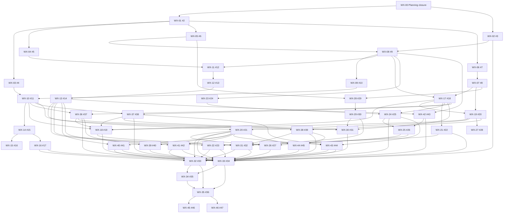

# Filed implementation backlog

Status: filed; 118 native relationships read back and matched on 2026-10-23, including 13 edges to 11 owner prerequisites; research remains incomplete. [WX-00 / #1](https://github.com/jvallery/weather/issues/1) gates application implementation. The [decision register](../decisions/implementation-register.md) distinguishes working choices from unresolved evidence. [Audit findings](../research/adversarial-audit.md) explain the changes from the seed.

The [machine-readable graph](backlog.json) records real issue numbers and IDs. Requirement links refer to the normative [requirements](../requirements.md), not only issue titles. Individual issues contain implementation approach, targeted acceptance/failure cases and operations/rollback obligations. [Owner prerequisites](owner-prerequisites.md) are filed and linked natively. Detailed contracts and qualification remain incomplete; do not interpret filing as readiness.

## Scope and sequence

The product is an independent observational weather archive: three-camera civil-segment timelapses, complete received local station history, private sparse originals, public delayed derivatives and evidence-grounded exploration. Exact source-time maps and durable provenance make comparisons useful without inventing measurements or hiding gaps. Local services, isolated identities and independent recovery preserve household systems and data.

Shared immutable asset publication no longer waits for the video renderer. Image products can use synthetic sealed-capture fixtures and the shared asset contract, with actual capture integration required for completion. Search documents can represent pending analysis; measured events/filters and almanac do not require AI. Integrated acceptance explicitly includes video encodes and every selected feature, so removing unnecessary implementation edges does not remove release gates.

No implementation task is ready **now**: WX-00 is open. After planning closure and scoped owner admission, the first independent foundation tasks are WX-01 and WX-02. Ready work is the set whose native prerequisites are complete, whose decisions are closed, and whose resource/access prerequisites are met. Recompute after each result; skip blocked branches and continue unrelated ready work. Never treat issue priority or an old closed prerequisite as live admission.

Use one task per coherent change, preserve unrelated work in isolated checkouts, run the cheapest meaningful check, deliver through its owner, and attach authoritative evidence before closing. Re-read current runtime/admission before an experiment or rollout. A failed qualification returns a precise blocked state with evidence and owner; it does not authorize changing shared infrastructure incidentally or weakening requirements.

## Dependency depth

This is a logical longest chain within Weather, **not an elapsed-time estimate** (task durations are unmeasured). Owner prerequisites additionally gate their listed consumers and can dominate elapsed time:

WX-01 → WX-05 → WX-08 → WX-11 → WX-12 → WX-13 → WX-42 → WX-25 → WX-31 → WX-32 → WX-34 → WX-35

The following levels expose work that can be scheduled independently once prerequisites and admission are satisfied:

- Level 0: WX-01, WX-02
- Level 1: WX-03, WX-04, WX-05, WX-06
- Level 2: WX-07, WX-08
- Level 3: WX-09, WX-11, WX-17, WX-23, WX-28
- Level 4: WX-10, WX-12, WX-19, WX-21, WX-24, WX-29
- Level 5: WX-13, WX-14, WX-27, WX-36, WX-37, WX-38
- Level 6: WX-15, WX-16, WX-18, WX-20, WX-22, WX-30, WX-42
- Level 7: WX-25, WX-39, WX-40, WX-41, WX-43, WX-44
- Level 8: WX-26, WX-31
- Level 9: WX-32, WX-33
- Level 10: WX-34
- Level 11: WX-35
- Level 12: WX-45, WX-46

Optional WX-15 (GPU) and WX-27 (CDN) do not block initial rollout unless explicitly activated with qualified admission and a corresponding rollout edge. CPU fallback and valid origin playback remain required. WX-45 is the accepted composite follow-on; WX-46 is deferred visual-index research. Neither is in initial acceptance closure.

## Issue index

| Key | GitHub | Requirement coverage | Phase / gate | Direct implementation prerequisites |
|---|---|---|---|---|
| WX-01 | [#2](https://github.com/jvallery/weather/issues/2) | R02, R08, R16, R27, R28 | initial_release / required | WX-00 planning |
| WX-02 | [#3](https://github.com/jvallery/weather/issues/3) | R02, R24, R27 | initial_release / required | WX-00 planning |
| WX-03 | [#4](https://github.com/jvallery/weather/issues/4) | R07, R08, R26, R28 | initial_release / required | WX-01 |
| WX-04 | [#5](https://github.com/jvallery/weather/issues/5) | R13, R27, R28 | initial_release / required | WX-01 |
| WX-05 | [#6](https://github.com/jvallery/weather/issues/6) | R14, R16, R22, R28 | initial_release / required | WX-01 |
| WX-06 | [#7](https://github.com/jvallery/weather/issues/7) | R17, R23, R26, R28, R29, R30, R31 | initial_release / required | WX-01 |
| WX-07 | [#8](https://github.com/jvallery/weather/issues/8) | R17, R18, R23, R27, R30, R31 | initial_release / required | WX-06 |
| WX-08 | [#9](https://github.com/jvallery/weather/issues/9) | R14, R19, R20, R22, R29, R30, R31, R33, R36 | initial_release / required | WX-02, WX-05 |
| WX-09 | [#10](https://github.com/jvallery/weather/issues/10) | R03, R04, R05, R30, R32, R34 | initial_release / required | WX-08 |
| WX-10 | [#11](https://github.com/jvallery/weather/issues/11) | R03, R06, R07, R08 | initial_release / required | WX-03, WX-09 |
| WX-11 | [#12](https://github.com/jvallery/weather/issues/12) | R13, R14, R15 | initial_release / required | WX-04, WX-08 |
| WX-12 | [#13](https://github.com/jvallery/weather/issues/13) | R14, R15, R20 | initial_release / required | WX-11 |
| WX-13 | [#14](https://github.com/jvallery/weather/issues/14) | R14, R15, R20, R26, R34, R35 | initial_release / required | WX-12 |
| WX-14 | [#15](https://github.com/jvallery/weather/issues/15) | R05, R09, R26 | initial_release / required | WX-10 |
| WX-15 | [#16](https://github.com/jvallery/weather/issues/16) | R09, R10, R28 | initial_release / conditional | WX-14 |
| WX-16 | [#17](https://github.com/jvallery/weather/issues/17) | R05, R11, R20 | initial_release / required | WX-14 |
| WX-17 | [#18](https://github.com/jvallery/weather/issues/18) | R03, R17, R19, R20, R29, R30, R31, R36 | initial_release / required | WX-07, WX-08 |
| WX-18 | [#19](https://github.com/jvallery/weather/issues/19) | R07, R19, R26, R29, R30 | initial_release / required | WX-10, WX-17, WX-19, WX-36, WX-37 |
| WX-19 | [#20](https://github.com/jvallery/weather/issues/20) | R11, R18, R25, R27, R29, R30, R31 | initial_release / required | WX-07, WX-17 |
| WX-20 | [#21](https://github.com/jvallery/weather/issues/21) | R11, R12, R15, R20, R29, R30, R31, R32 | initial_release / required | WX-13, WX-19 |
| WX-21 | [#22](https://github.com/jvallery/weather/issues/22) | R21, R28 | initial_release / required | WX-17 |
| WX-22 | [#23](https://github.com/jvallery/weather/issues/23) | R19, R20, R21 | initial_release / required | WX-13, WX-21 |
| WX-23 | [#24](https://github.com/jvallery/weather/issues/24) | R22, R24 | initial_release / required | WX-08 |
| WX-24 | [#25](https://github.com/jvallery/weather/issues/25) | R19, R20, R22, R36 | initial_release / required | WX-17, WX-23 |
| WX-25 | [#26](https://github.com/jvallery/weather/issues/26) | R22, R26, R27, R35 | initial_release / required | WX-24, WX-42 |
| WX-26 | [#27](https://github.com/jvallery/weather/issues/27) | R12, R20, R22, R35 | initial_release / required | WX-20, WX-25 |
| WX-27 | [#28](https://github.com/jvallery/weather/issues/28) | R11, R18, R25 | initial_release / conditional | WX-19 |
| WX-28 | [#29](https://github.com/jvallery/weather/issues/29) | R16, R17, R23 | initial_release / required | WX-05, WX-07 |
| WX-29 | [#30](https://github.com/jvallery/weather/issues/30) | R17, R23, R28, R29, R30 | initial_release / required | WX-28 |
| WX-30 | [#31](https://github.com/jvallery/weather/issues/31) | R19, R20, R23, R29, R30 | initial_release / required | WX-17, WX-29, WX-36, WX-37 |
| WX-31 | [#32](https://github.com/jvallery/weather/issues/32) | R10, R15, R16, R26, R29, R30, R31 | initial_release / required | WX-13, WX-18, WX-25, WX-29, WX-38 |
| WX-32 | [#33](https://github.com/jvallery/weather/issues/33) | R11, R14, R16, R20, R21, R22, R23, R26, R29, R30, R31, R33, R34, R35, R36 | initial_release / required | WX-16, WX-20, WX-22, WX-24, WX-30, WX-31, WX-40, WX-41, WX-43 |
| WX-33 | [#34](https://github.com/jvallery/weather/issues/34) | R03, R04, R05, R06, R08, R09, R11, R12, R13, R18, R21, R24, R27, R28, R29, R30, R31, R32, R33, R34, R35, R36, R37 | initial_release / required | WX-02, WX-18, WX-20, WX-21, WX-22, WX-26, WX-31, WX-36, WX-37, WX-38, WX-39, WX-40, WX-41, WX-42, WX-43, WX-44, WX-16 |
| WX-34 | [#35](https://github.com/jvallery/weather/issues/35) | R02, R23, R24, R26, R27 | initial_release / required | WX-32, WX-33 |
| WX-35 | [#36](https://github.com/jvallery/weather/issues/36) | R01, R02, R03, R04, R05, R06, R07, R08, R09, R10, R11, R12, R13, R14, R15, R16, R17, R18, R19, R20, R21, R22, R23, R24, R25, R26, R27, R28, R29, R30, R31, R32, R33, R34, R35, R36, R37 | initial_release / required | WX-32, WX-33, WX-34 |
| WX-36 | [#37](https://github.com/jvallery/weather/issues/37) | R29, R04, R19, R20 | initial_release / required | WX-10, WX-17 |
| WX-37 | [#38](https://github.com/jvallery/weather/issues/38) | R30, R07, R17, R18, R19, R23 | initial_release / required | WX-10, WX-17 |
| WX-38 | [#39](https://github.com/jvallery/weather/issues/39) | R31, R08, R18, R19 | initial_release / required | WX-10, WX-19 |
| WX-39 | [#40](https://github.com/jvallery/weather/issues/40) | R32, R12, R20 | initial_release / required | WX-20, WX-36 |
| WX-40 | [#41](https://github.com/jvallery/weather/issues/41) | R33, R14, R20, R21 | initial_release / required | WX-13, WX-20 |
| WX-41 | [#42](https://github.com/jvallery/weather/issues/42) | R34, R14, R15, R24 | initial_release / required | WX-13, WX-20 |
| WX-42 | [#43](https://github.com/jvallery/weather/issues/43) | R35, R14, R20, R22 | initial_release / required | WX-08, WX-13 |
| WX-43 | [#44](https://github.com/jvallery/weather/issues/44) | R36, R19, R20, R21, R22, R27 | initial_release / required | WX-20, WX-24, WX-37 |
| WX-44 | [#45](https://github.com/jvallery/weather/issues/45) | R37, R12, R15, R24, R27 | initial_release / required | WX-20, WX-38 |
| WX-45 | [#46](https://github.com/jvallery/weather/issues/46) | R38, R04, R05, R11, R19, R20, R23 | follow_on / none | WX-35 |
| WX-46 | [#47](https://github.com/jvallery/weather/issues/47) | R22, R10, R24, R27 | deferred_research / none | WX-35 |

## Graph

Arrows run from prerequisite to dependent. WX-00 represents planning closure; the graph does not model runtime calls.

